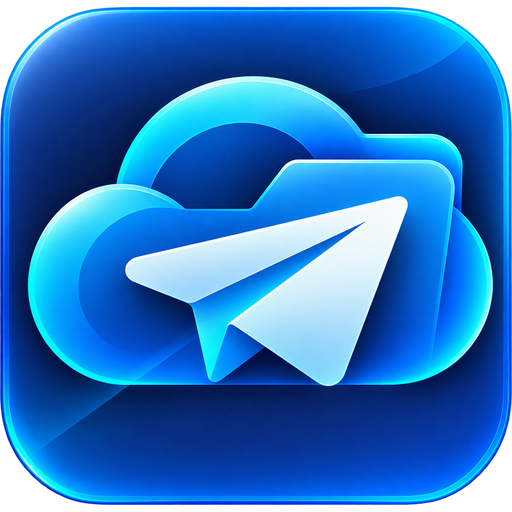
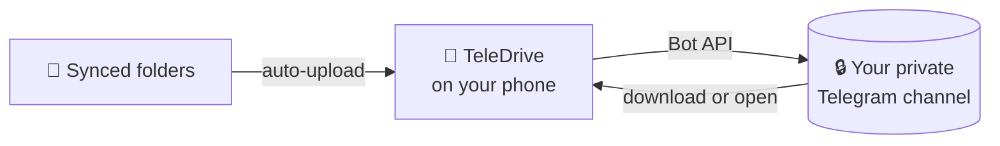

<div align="center">

<br/>



# TeleDrive

### Your personal cloud drive, powered by Telegram

<p>
  <strong>Your files. Your channel. Your cloud.</strong><br/>
  <em>Back up photos, videos, music and documents to a private Telegram channel, sync folders automatically, and get everything back anywhere.</em>
</p>

<br/>

<p align="center">
  <a href="https://github.com/aravindrejidev/TelDrive/releases"></a>
  <a href="https://github.com/aravindrejidev/TelDrive/stargazers"></a>
  <a href="https://github.com/aravindrejidev/TelDrive/releases"></a>
  <a href="https://github.com/aravindrejidev/TelDrive/blob/main/LICENSE"></a>
</p>

<p align="center">
  
  
  
  
  
</p>
<br/>

[**Showcase**](#showcase) · [**Features**](#features) · [**How it works**](#how-it-works) · [**Download**](#download) · [**Architecture**](#architecture) · [**Contributing**](#contributing) · [**Support**](#support) · [**Disclaimer**](#disclaimer)

<br/>

</div>

> [!NOTE]
> TeleDrive is an unofficial, independent project and is not affiliated with Telegram. Your files are stored on Telegram's servers, in a channel that you create and control. See [Disclaimer](#disclaimer).

---

<a id="about"></a>
## 🌟 About the Project

**TeleDrive** is a native-feeling Android app that turns a private Telegram channel into your own cloud drive. You create a bot and a channel, paste them into the app once, and from then on your photos, videos, music and documents have a home that you fully control.

Pick a file and it uploads. Link a folder to a channel and every new file in it uploads on its own, in the background. Delete the copy on your phone and the file is still listed in TeleDrive, ready to download again whenever you need it.

No accounts. No ads. No analytics. No server in the middle: the app talks straight to Telegram, and uses the network for nothing else except checking GitHub for new versions.

---

<a id="showcase"></a>
## 📸 Showcase

<div align="center">
  
  <br/><br/>
  <table>
    <tr>
      <td width="33%" align="center">
        <br />
        <sub><b>Home</b></sub>
      </td>
      <td width="33%" align="center">
        <br />
        <sub><b>File Details</b></sub>
      </td>
      <td width="33%" align="center">
        <br />
        <sub><b>Folder Sync</b></sub>
      </td>
    </tr>
    <tr>
      <td width="33%" align="center">
        <br />
        <sub><b>Settings</b></sub>
      </td>
      <td width="33%" align="center">
        <br />
        <sub><b>In-app Updater</b></sub>
      </td>
      <td width="33%" align="center">
        <br />
        <sub><b>About</b></sub>
      </td>
    </tr>
  </table>
</div>

---

<a id="features"></a>
## ✨ Features

<div align="center">

<table>
  <tr>
    <td width="50%" valign="top">

#### Your Library
- **Photos, Videos, Audio and Documents** tabs, with live upload progress.
- **Search and sort** by newest, oldest, name or size, and pick the tab the app opens on.
- **Always listed** — every file is tracked in a local database, so it stays visible after you delete the copy on your phone.
- **Download again** any time, or **open it in Telegram** — handy for files too big for a bot to download.
- **Remove from the app only, or delete permanently** (which also deletes the Telegram message). Files you remove are never uploaded again by Sync.
- **Storage overview** with the size of each category.

#### Uploads
- **Upload queue** — up to four at a time, with a one-tap **Retry** for anything that fails.
- **Original quality** — photos go out as files, so Telegram never recompresses them. Formats Telegram can't handle natively (FLAC, WAV, MKV and more) are sent as documents and arrive byte for byte.
- **Silent uploads** — no channel notification for every file.
- **Rate-limit aware** — if Telegram says slow down, TeleDrive waits and retries instead of failing.

    </td>
    <td width="50%" valign="top">

#### Folder Sync
- **Sync links** — pair any folder on your phone with any channel, for example *Lossless Music* → a *Music* channel. Add as many as you like with one bot.
- **Automatic background sync** every 15 minutes up to once a day, powered by WorkManager.
- **Smart conditions** — sync only on Wi-Fi, only while charging, or only when the battery isn't low.
- **Sync now** for one link or all of them, with a clear report of what uploaded, failed or was skipped.
- **Careful with unfinished files** — anything still being copied or downloaded waits for the next run.

#### Experience
- **Neumorphic design** — soft, raised and pressed-in surfaces, in light, dark or following your phone.
- **Five accent colours**, haptic feedback you can switch off, and smooth animated transitions.
- **Settings by section** — Appearance, Library, Uploads, Sync, Storage, Telegram connection, Updates and About.
- **In-app updater** — when a new release is out, a sheet slides up with what changed, then downloads, verifies and installs it for you.

#### Private by Design
- **No server, no ads, no analytics.**
- Your Bot Token is kept in Android's **secure storage** and never leaves the phone except to talk to Telegram.
- Updates are fetched only from GitHub and **verified with SHA-256** before they can be installed.

    </td>
  </tr>
</table>

<details>
<summary><b>All settings at a glance</b></summary>
<br/>

| Section | What you can change |
|---|---|
| **Appearance** | Theme (system, light, dark), accent colour, haptic feedback |
| **Library** | Default sort order, which tab opens first, photo thumbnails, confirm before permanent delete |
| **Uploads** | Original photo quality, silent uploads, how many uploads run at once |
| **Sync** | Sync links, check interval, only on Wi-Fi, only while charging, only when the battery is not low |
| **Storage and data** | Size per category, clear downloaded copies, forget removed files |
| **Telegram connection** | Test the connection, change the token or channel, disconnect |
| **Updates** | Check now, check when the app opens, clear downloaded updates |
| **About** | Version and build, developer, source and issue links, licences |

</details>

</div>

---

<a id="how-it-works"></a>
## 🔄 How It Works

TeleDrive uses the official **Telegram Bot API**. A bot you create posts your files into a private channel that only you can see, and the app remembers where each one went.



| You do this | TeleDrive does this |
|---|---|
| Create a bot with **@BotFather** | Uses its token to talk to Telegram on your behalf |
| Create a private channel and add the bot as an admin | Treats that channel as your storage |
| Pick a file in a tab | Uploads it to your main channel and remembers it |
| Link a folder to a channel | Uploads new files in the background, on your schedule |
| Delete a file from your phone | Keeps it listed, so you can download it again later |

### Telegram's limits

These come from Telegram, not from TeleDrive.

| Limit | Value |
|---|---|
| Largest file a bot can **upload** | 50 MB |
| Largest file a bot can **download** again | 20 MB |
| Files above the download limit | Still stored, and one tap opens them in Telegram |

---

<a id="download"></a>
## 📥 Download & Installation

<div align="center">

<a href="https://github.com/aravindrejidev/TelDrive/releases/latest" target="_blank" rel="noopener noreferrer"></a>
<a href="https://apps.obtainium.imranr.dev/redirect?r=obtainium://add/https://github.com/aravindrejidev/TelDrive" target="_blank" rel="noopener noreferrer"></a>

Grab the latest signed APK from the [Releases](https://github.com/aravindrejidev/TelDrive/releases) page. Sideloading requires enabling "Install unknown apps" for whichever app you download it with. TeleDrive runs on **Android 6.0 and newer**.

Once installed, TeleDrive tells you when a new version is out and can download and install it for you.

</div>

### Getting Started
1. **Create a bot.** In Telegram, message [@BotFather](https://t.me/BotFather), send `/newbot`, and copy the **bot token** it gives you.
2. **Create a channel.** Make a new **private** channel, then add your bot to it as an **administrator** who can post messages.
3. **Connect.** Open TeleDrive and paste the token and the channel. For the channel you can use `@username`, the numeric ID (it starts with `-100`), or simply a link to any post in it.
4. **Use it.** Tap **Upload** to add files, or open **Settings → Sync** to link a folder and let new files upload on their own.

TeleDrive checks the token and the bot's permissions the moment you connect, so a wrong setup is reported right away rather than as a failed upload later.

### Building from Source
```bash
git clone https://github.com/aravindrejidev/TelDrive.git
cd TelDrive
flutter pub get
flutter run
```
*Prerequisites:* Flutter 3.35 or newer, the Android SDK and JDK 17. Release builds are made by a manual GitHub Actions workflow; see [docs/RELEASING.md](docs/RELEASING.md) for how to publish one.

---

<a id="architecture"></a>
## 🏗️ Architecture & Tech Stack

TeleDrive is a single-module Flutter app. State lives in small `ChangeNotifier` providers, and the Telegram, sync and storage work is plain Dart with no backend of its own.

| Folder | What it does |
|---|---|
| `lib/screens/` | Home, onboarding, file preview, and Settings (a home screen plus one page per section, and About) |
| `lib/widgets/neu/` | The neumorphic design system: surfaces, buttons, switches, tabs, dialogs, sheets |
| `lib/widgets/update/` | The animated update sheet |
| `lib/providers/` | App state: settings, files, uploads and updates |
| `lib/services/` | Telegram Bot API client, sync engine with WorkManager, SQLite, secure storage, update service |
| `lib/models/` | Files, sync links and release info |
| `lib/theme/` | Colours, accent palettes and the theme builder |
| `lib/utils/` | Helpers, formatters, haptics and build information |

**Built with:** Flutter · Dart · Provider · sqflite · WorkManager · flutter_secure_storage · Telegram Bot API · GitHub Actions

---

<a id="support"></a>
## ☕ Support the Project

TeleDrive is free and open source, with no ads or subscriptions. If it's useful to you, you can support it by:

- ⭐ **Starring** the repository
- 📣 **Sharing** it with friends who live in Telegram
- 🐛 **Reporting** bugs and ideas on the [issues page](https://github.com/aravindrejidev/TelDrive/issues)

<!-- Add your donation links here, for example Ko-fi or PayPal -->

### 📈 Star History

<p align="center">
  <a href="https://star-history.com/#aravindrejidev/TelDrive&Date">
    
  </a>
</p>

---

<a id="contributing"></a>
## 💡 Contributing

Contributions are welcome, whether it's a bug fix, a new idea, or better wording.

- Found something that doesn't work? Open an [issue](https://github.com/aravindrejidev/TelDrive/issues) and tell us what you did, what you expected, and your Android version.
- For bigger changes, open an issue first so we can talk it through.
- Pull requests should pass `flutter analyze` and `flutter test`.

### 👥 Contributors

<div align="center">
  <a href="https://github.com/aravindrejidev/TelDrive/graphs/contributors">
    
  </a>
</div>

---

<a id="acknowledgments"></a>
## 🤝 Acknowledgments

- **[Telegram Bot API](https://core.telegram.org/bots/api)** — the foundation that makes a channel usable as storage.
- **[Flutter](https://flutter.dev/)** and the packages behind the app: `provider`, `sqflite`, `workmanager`, `flutter_secure_storage`, `file_picker`, `open_filex` and `url_launcher`.
- **GitHub Releases and Actions** — for building, publishing and delivering updates.

---

<a id="disclaimer"></a>
## ⚖️ License & Disclaimer

### License
See the [LICENSE](LICENSE) file for details.

### Disclaimer
- **Unofficial.** TeleDrive is not made by, endorsed by or affiliated with Telegram. Use it in line with Telegram's terms and Bot API rules.
- **Your files live on Telegram's servers.** Channel posts are not end-to-end encrypted. Keep your channel private, and don't store anything you wouldn't trust to Telegram.
- **Not a replacement for a real backup.** Telegram can change its limits or terms, and channels or accounts can be removed. Keep a second copy of anything you can't lose.
- **Size limits apply.** A bot can upload files up to 50 MB and download files up to 20 MB. Larger files can't be synced, and can't be downloaded back through the app.
- **Guard your Bot Token.** Anyone with it can act as your bot. TeleDrive keeps it in Android's secure storage and sends it only to Telegram.
- **Privacy.** There is no TeleDrive server and no analytics. The app contacts Telegram to store and fetch your files, and GitHub to check for updates and show the developer's picture in About.

---

<div align="center">
  Made with care for people whose life is already in Telegram. 📦
</div>
